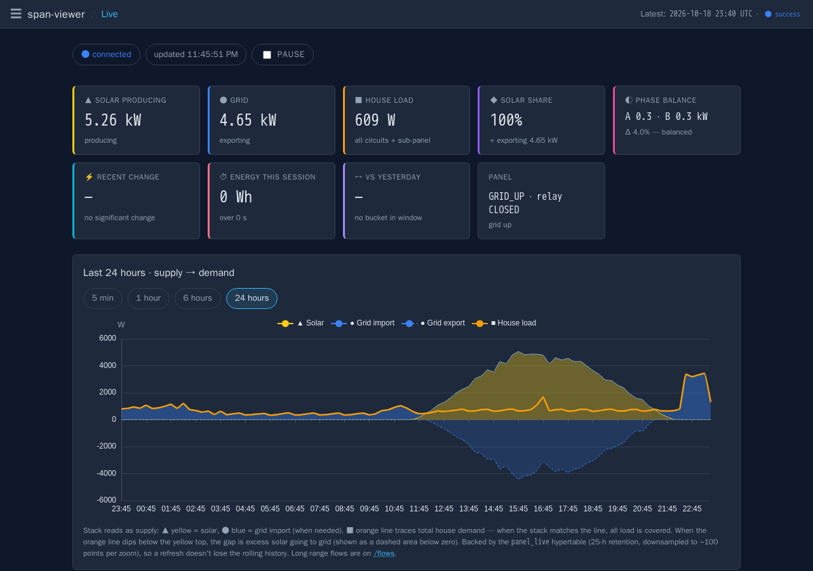
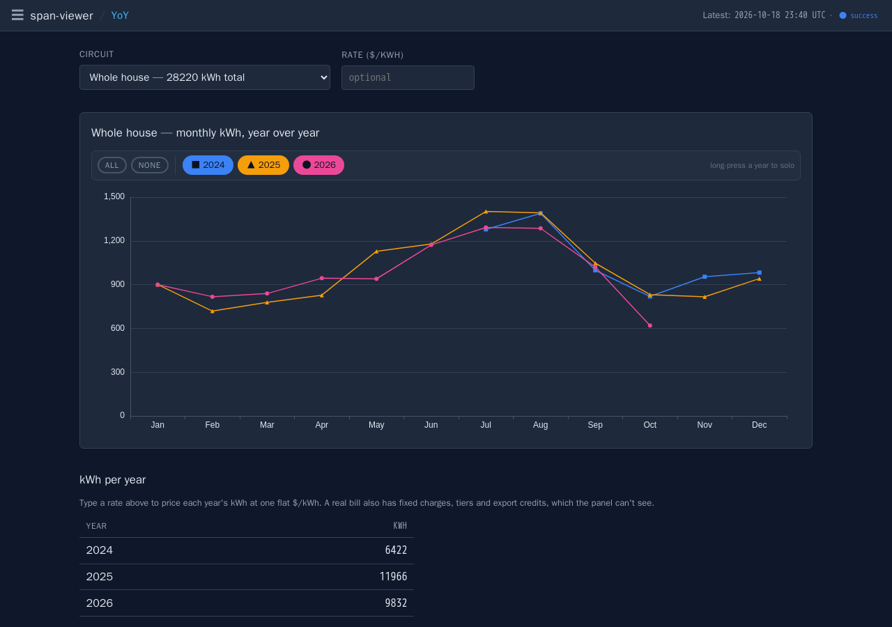
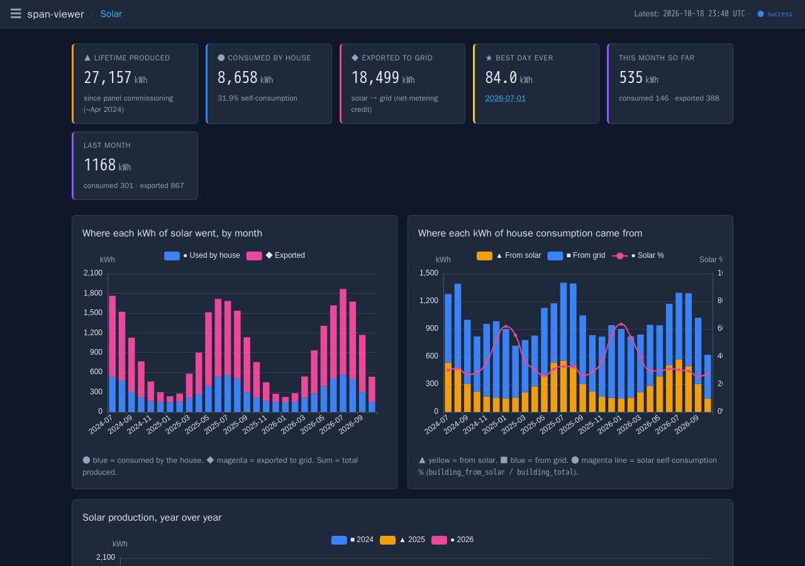
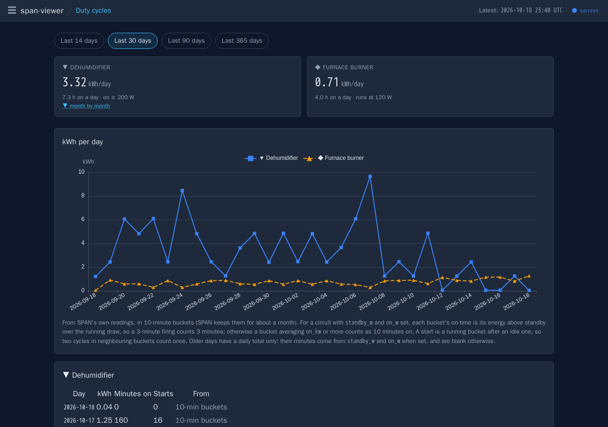
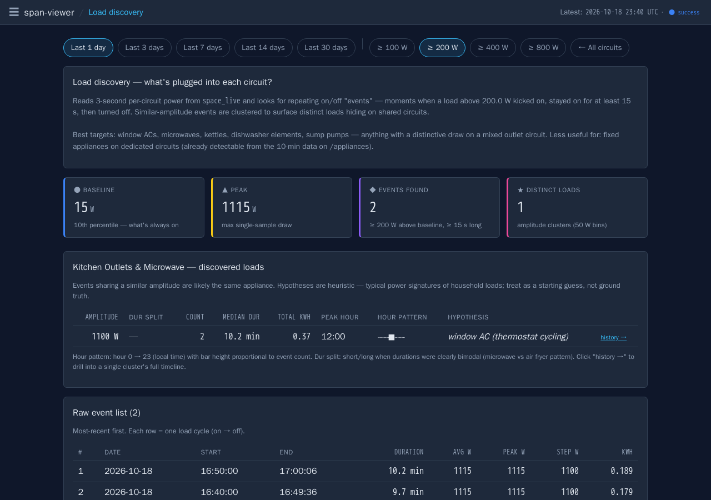

# span-viewer

Historical analytics for a [SPAN](https://www.span.io/) smart electrical panel: years of whole-house, per-circuit and solar energy history in one self-hosted web app, instead of exporting CSVs one screen at a time from SPAN's phone app.

Everything it shows comes from your panel's own data. It pulls the history from SPAN's cloud, reads the live state from the panel on your LAN, and keeps both in TimescaleDB.



> **Unofficial.** SPAN doesn't publish an API for its cloud history. The 10-minute ingest uses the same cloud API as SPAN's phone app (its public Cognito app ids are in `ingester/backfill.py`), so it can break whenever SPAN changes it. The live view uses SPAN's documented local API (eBus MQTT, firmware r202633 or later). Not affiliated with SPAN.

## What you get

| Page | What it shows |
|---|---|
| `/live` | Real-time power (3-second refresh): solar, grid, house load, phase balance, each circuit ranked, a strip chart that survives a reload |
| `/yoy` | Monthly kWh year over year, whole house or any circuit |
| `/top`, `/biggest`, `/hours`, `/day`, `/heatmap` | Top consumers, biggest days, hour-of-day patterns, a single day's curves for every circuit, calendar heatmaps |
| `/solar`, `/flows` | Production, self-consumption, where each kWh came from and went, capacity factor, a year-end projection, a Sankey of the flows |
| `/sessions`, `/appliances`, `/duty` | EV charging sessions, sessions of the appliances you name in `circuits.yaml`, and kWh, minutes on and starts per day for circuits that cycle (a furnace, a dehumidifier, a sump pump) |
| `/anomalies` | Circuits that ran far above their own baseline |
| `/discover`, `/attribute` | Load disaggregation from 3-second data: edge detection, clustering, thermostat-cycling and co-occurrence finders, and a factorial-HMM that splits a mixed circuit into its appliances |
| `/health` | Ingest runs, data freshness, row counts, export links |

Plus CSV and JSON exports under `/export/*`, a read-only JSON API under `/api/v1/*` (see [API v1](#api-v1-stable-contract)), MQTT publishing with Home Assistant discovery, and an installable PWA for your phone's home screen.

Costs are optional: set one flat `$/kWh` and the pages that price energy show `$`; leave it unset and everything is kWh. Real utility bills (tiers, riders, net-metering credits) are out of scope.

Colours are chosen for colour-blind readers: hue-distinct palettes (blue, orange, yellow, magenta, violet), never red against green, and every series or status also has its own glyph (■ ▲ ● ◆).

| | |
|---|---|
|  |  |
|  |  |

The screenshots are from the synthetic sample house (`scripts/sample_data.py`), not a real one.

## Try it with sample data

```bash
docker compose up
```

Then open <http://localhost:8000>. Compose starts TimescaleDB, fills an empty database with a synthetic house the first time (two years of readings at SPAN's resolutions and 24 hours of 3-second live rows), and serves the app. No panel or account needed.

## Run it against your panel

You need a SPAN panel, the email and password of your SPAN app account, and a machine on the panel's LAN that runs Docker (or Debian with systemd, below).

1. **Settings.** Copy [config.example.toml](config.example.toml) and set at least `TZ`. With Docker Compose, put the same names in a `.env` file beside `docker-compose.yml`; its header lists the ones that matter there (`SPAN_SAMPLE_DATA=0`, `SPAN_LIVE_SOURCE=ebus`, `TZ`).
2. **Cloud history.** Put `{"email": "...", "password": "..."}` in `config/credentials.json`. The ingest signs in to SPAN's cloud with it.
3. **Live data.** Register span-viewer as a client of the panel's own MQTT broker. `scripts/register-span-api-v2.py --base-url http://<panel-ip>` prompts for the panel's passphrase (SPAN app → Settings → On-Prem Settings) and writes `span-api-credentials.json` and `span-ca.pem`; or press the panel's door switch three times and add `--door-bypass`. With Docker, write them into `./config`:
   ```bash
   docker compose run --rm -v ./config:/out app python scripts/register-span-api-v2.py --base-url http://192.168.1.50 --out /out/span-api-credentials.json --ca-out /out/span-ca.pem
   ```
4. **Your circuits.** Copy [circuits.example.yaml](circuits.example.yaml) to `config/circuits.yaml` and say which circuits are which appliances, which one is the EV charger, and which ones cycle. Everything in it is optional.
5. **Start.** `docker compose --profile panel up -d` adds the 10-minute cloud ingest. Load the history once with `docker compose run --rm ingester python -m ingester.backfill` (about 70 calls, a few minutes).

**Without Docker** (Debian 13, as root): `scripts/install-timescaledb.sh` installs Postgres 17 with TimescaleDB and creates the database, `scripts/apply-schema.sh` applies `db/schema/`, and the units in [systemd/](systemd/) run the app (`span-viewer-app.service`), the 10-minute ingest and the optional firmware watch from `/opt/span-viewer`. They read their settings from `/etc/span-viewer/span-viewer.env`.

**Exposure.** There is no login screen. Keep it on your LAN or behind a VPN, or put an authenticating reverse proxy in front (and set `FORWARDED_ALLOW_IPS` to the proxy's address).

## Configuration

Every setting is read from the environment, then `/etc/span-viewer/config.toml` or `/etc/span-viewer/span-viewer.env` (KEY=VALUE, the systemd units' `EnvironmentFile=`), then a default. No default names a host: a feature whose host isn't set is off. [app/config.py](app/config.py) reads them all and [config.example.toml](config.example.toml) documents them.

| Setting | What it does |
|---|---|
| `TZ` | Time zone for every local day (default UTC) |
| `DATABASE_URL` | Postgres (TimescaleDB) |
| `SPAN_HOST` | The panel's address; unset, the addresses stored in the credentials files |
| `SPAN_LIVE_SOURCE` | `ebus` (default: the panel's MQTT broker), `v1` (the old REST API, until SPAN retires it), `shadow` (both, compared), or `off` |
| `MQTT_URL`, `MQTT_USERNAME`, `MQTT_PASSWORD`, `MQTT_HA_PREFIX` | Republish the live snapshot to your MQTT broker, with Home Assistant discovery |
| `NTFY_URL`, `NTFY_TOPIC`, `APP_URL` | A push when the panel's firmware changes (the topic is a secret) |
| `RATE_IMPORT_PER_KWH`, `RATE_EXPORT_CREDIT_PER_KWH` | An optional flat tariff; unset, every page is kWh-only |
| `VM_URL`, `VM_SOLAR_SERIES`, `VM_LOAD_SERIES` | Optional: compare the history with a VictoriaMetrics that records the panel's power, on `/health` |
| `REDIRECTS` | Paths answered with a 301 to another URL; none by default |
| `FORWARDED_ALLOW_IPS` | Reverse proxies uvicorn trusts for `X-Forwarded-*` |
| `CIRCUITS_FILE` | Where circuits.yaml is (default `/etc/span-viewer/circuits.yaml`) |

## How the data works

SPAN's cloud keeps your history at falling resolution: 10-minute buckets for about a month, hourly for about three months, daily for about two years, and monthly back to commissioning. The backfill takes each tier as far back as it goes and skips the empty padding SPAN returns past each edge; the 10-minute ingest then keeps today and yesterday current. The live poller writes the panel's state every 3 seconds to `panel_live` (25 hours kept) and every circuit's power to `space_live` (30 days, compressed), which feeds `/live` and the load-disaggregation pages.

A sub-panel fed from the panel's feedthrough lugs has no per-circuit metering: span-viewer shows it as one more load, named in `circuits.yaml`.

## API v1 (stable contract)

`/api/v1/*` is a versioned, read-only JSON API for other services (Home Assistant, dashboards, scripts). `GET /api/v1` lists every endpoint; `/docs` and `/openapi.json` give the parameters.

**Stability rules.** Within v1, an endpoint's path, parameters, field names, units and meanings don't change, and no endpoint or field is removed. New endpoints, new optional parameters and new fields may be added, so clients must ignore fields they don't know. Anything breaking goes under `/api/v2`, with v1 kept alongside until its consumers have moved.

Conventions: energy is kWh and power is W; dates are `YYYY-MM-DD` local days in the configured `TZ`, timestamps ISO 8601. Bad parameters get a 400 with `{"detail": "..."}`. No auth, like the pages.

### `GET /api/v1/panel/daily?start=YYYY-MM-DD&end=YYYY-MM-DD`

Panel totals per local day, `start` to `end` inclusive. `end` defaults to today (a later `end` is clipped to today), `start` to 29 days before `end`; at most 3660 days per call. Every day in the range gets a row, so a gap shows as low `coverage`, never as a missing row.

```json
{"timezone": "America/Chicago", "start": "2026-10-16", "end": "2026-10-17",
 "days": [{"date": "2026-10-16", "import_kwh": 43.13, "export_kwh": 0.20,
           "solar_kwh": 5.59, "load_kwh": 48.52, "coverage": 1.0, "resolution_s": 600}, ...]}
```

| Field | Meaning |
|---|---|
| `import_kwh` | From the utility (SPAN `grid_consuming`) |
| `export_kwh` | To the utility (SPAN `solar_to_grid`) |
| `solar_kwh` | Produced by the PV system (SPAN `solar`) |
| `load_kwh` | Used by the house (SPAN `building_total`); without a battery, `import - export + solar = load` to float rounding |
| `coverage` | Share of the local day covered by readings, 0 to 1 (DST days are 23 or 25 h). Below 1: today so far, or a gap in SPAN's cloud |
| `resolution_s` | Widest reading that day: 600, 3600 or 86400, following SPAN's retention tiers |

Every kWh field is null when `coverage` is 0, which includes the months where SPAN keeps only monthly figures; `solar_kwh` and `export_kwh` are null on days SPAN reported no solar series. Totals are summed from the readings (`panel_readings`), not the `panel_daily` rollup, which buckets by UTC day.

## Development

- Python 3.13, FastAPI, Jinja2 + HTMX, ECharts, psycopg 3, NumPy. No front-end build step.
- `ruff check .` lints; `pytest` runs the config tests, and the page and API smoke tests when `DATABASE_URL` points at a database with the schema and the sample data ([.gitlab-ci.yml](.gitlab-ci.yml) does exactly that).
- `python scripts/screenshots.py` retakes `docs/screenshots/` from the sample data.
- `scripts/release-public.sh` builds a release as one fresh commit and scans it with gitleaks and `scripts/release_check.py` (a deny list kept outside the repo) before anything is pushed.
- Sign conventions differ between SPAN's surfaces (circuit power is negative when consuming, the grid flow is inverted between APIs): `app/span_local.py` and `app/span_ebus.py` normalise both to "positive = consuming".

## Licence

MIT, see [LICENSE](LICENSE). SPAN is a trademark of SPAN.IO, Inc.; this project isn't endorsed by it.
